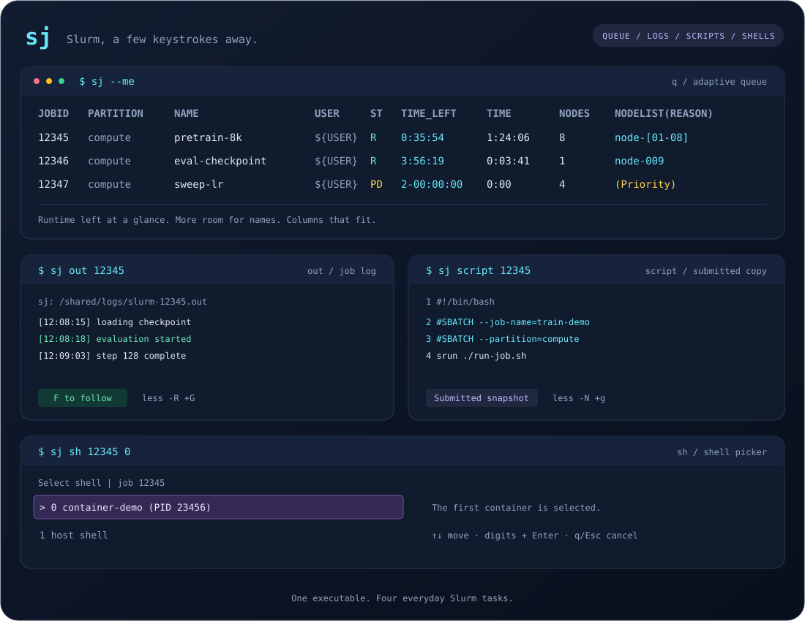

<div align="center">

# sj

### Slurm, a few keystrokes away.

Read the queue. Open the log. Inspect the script. Step into your job.

<p>
  
  
  
  
</p>

**English** · [简体中文](README.zh-CN.md)

[Quick start](#quick-start) · [Installation](#installation) · [Commands](#commands) · [Keybindings](#keybindings) · [Development](#development)



<sub>Illustrative session. Job names, nodes, and log contents are examples.</sub>

</div>

`sj` brings four everyday Slurm tasks into one small Rust executable: see what is running, find a job's output, inspect its submitted script, and open a shell on the right node or inside an existing Enroot container.

## Why sj?

| Your next task | One command | What you get |
| --- | --- | --- |
| Check the queue | `sj --me` | Terminal-aware columns, runtime remaining, and space for meaningful job names. |
| Read the output | `sj out 12345` | The sbatch log resolved from Slurm metadata and opened in `less`. |
| Inspect the submission | `sj script 12345` | The submitted script, opened from the beginning with line numbers. |
| Inspect a running job | `sj sh 12345` | A node picker, then a container or host shell. |

- **Room to breathe.** Wide terminals show `TIME_LEFT`, `TIME`, `PARTITION`, and `NODELIST(REASON)`; narrow terminals compact the view.
- **Familiar filters.** Keep using `--me`, `--start`, `-u`, `-j`, `-t`, `-p`, and other `squeue` options.
- **A menu that fits.** Node and container pickers scroll within the terminal height and react to resizing.
- **Containers first.** Enter confirms the highlighted container; the host shell remains the last choice.
- **One executable.** The Linux x86_64 and aarch64 release binaries are statically linked and run without activating a venv or installing a Python or Rust runtime.

## Quick start

```bash
sj --me                       # Your queue, fitted to the terminal
sj --me --start               # Pending jobs and expected start times
sj out 12345                   # Open the job's output at the end
sj script 12345                # Read the submitted script from the beginning
sj sh 12345                    # Pick a node, then a shell
```

Replace `12345` with your job ID. For a new setup, follow [Installation](#installation).

## Installation

### Runtime requirements

| Feature | Available on `PATH` |
| --- | --- |
| Queue | `squeue` |
| Logs | `sacct`, `scontrol`, `less` |
| Submitted scripts | `scontrol`; `sacct` for historical retrieval; `less` for interactive viewing |
| Node and container shells | `scontrol`, `srun`; `enroot` on the target node for container entry |

Release builds support **x86_64 and aarch64 Linux**, using static musl binaries. For `sh`, the executable's path must be accessible on the compute nodes, typically through a shared home directory; login and compute nodes must use a compatible architecture.

### Download a release

Download the archive matching your Linux architecture from [Releases](https://github.com/flymin/sj/releases):

| Architecture (`uname -m`) | Release target |
| --- | --- |
| `x86_64` | `x86_64-unknown-linux-musl` |
| `aarch64` | `aarch64-unknown-linux-musl` |

```bash
SJ_VERSION=0.1.0
SJ_TARGET="$(uname -m)-unknown-linux-musl"
SJ_ARCHIVE="sj-v${SJ_VERSION}-${SJ_TARGET}.tar.gz"
curl -fLO "https://github.com/flymin/sj/releases/download/v${SJ_VERSION}/${SJ_ARCHIVE}"
curl -fLO "https://github.com/flymin/sj/releases/download/v${SJ_VERSION}/SHA256SUMS"
sha256sum --check --ignore-missing SHA256SUMS
tar -xzf "$SJ_ARCHIVE" sj
mkdir -p "$HOME/local/bin"
install -m 755 sj "$HOME/local/bin/sj"
```

Release archives contain the executable, both READMEs, and the terminal preview. The binary needs no Rust or Python runtime; the Slurm commands listed above remain runtime requirements.

### Build and install

The scripts use an **existing uv venv** for compiler tooling: `SJ_VENV` takes priority, followed by the active `VIRTUAL_ENV`, then `$HOME/.venvs/dev`. The examples assume a checkout at `~/local/src/sj`.

```bash
cd ~/local/src/sj

# First-time toolchain setup; skip if already configured.
SJ_VENV="$HOME/.venvs/dev" SJ_UV="$(command -v uv)" ./setup-toolchain.sh

# Check, build, and install the static executable.
SJ_VENV="$HOME/.venvs/dev" SJ_INSTALL_DIR="$HOME/local/bin" ./build.sh

export PATH="$HOME/local/bin:$PATH"
sj -h
```

The build script checks formatting, runs tests and Clippy, builds a release binary, verifies static linkage, and installs it as `~/local/bin/sj`. Build output is saved to `.logs/build.log`; temporary build directories are cleaned up on exit. Local account and filesystem identifiers are replaced with environment placeholders in build/setup logs, and compiler paths are remapped inside the binary. Documentation and previews use fictional identifiers.

## Commands

| Command | Purpose |
| --- | --- |
| `sj [q] [OPTIONS]` | Show the queue; `q` is the default command. |
| `sj out JOBID [OPTIONS]` | Open stdout, stderr, or print the resolved log path. |
| `sj script JOBID [OPTIONS]` | View Slurm's submitted script copy, or print it with `--raw`. |
| `sj sh JOBID [NODE_INDEX] [OPTIONS]` | Choose a node and open a container or host shell. |
| `sj help [COMMAND]` | Show general or command-specific help. |

Every level accepts **`-h` and `--help`**. `sj -h` introduces the commands; `sj q -h`, `sj out -h`, `sj script -h`, and `sj sh -h` each show usage, options, and examples. Help works without contacting Slurm.

### Queue · `q`

```bash
sj q --me --start
sj q --me -t RUNNING -i 5
sj q -u "${USER}" -p compute --width 120
sj q --me --noheader
sj q --me --json
```

The layout reserves space for job names. Wide screens show **`TIME_LEFT`** alongside **`TIME`** (elapsed), plus `PARTITION` and native `NODELIST(REASON)`. As the terminal narrows, `TIME_LEFT` is hidden first. Remaining time is Slurm's unused runtime under the job's time limit, rather than an estimate of when the workload will finish. Pending jobs show their unused time limit.

If more compression is needed, time, `USER`, and `JOBID` can shrink to **5**, **5**, and **7** display columns respectively; shorter fields are not padded up to these minimums. Long durations become `1d02h`, `1h23m`, or `12h`; unlimited and unknown values become `∞` and `?` when necessary. Job IDs end with `…`, while usernames are truncated directly. Full values return when space permits; native formats or `--json` retain complete values regardless of terminal width. Long node lists use an ellipsis, and narrow pending reasons use labels such as `Prio`, `Res`, or `Dep`.

`--start` shows pending jobs in expected-start order, following native Slurm behavior, and keeps `START_TIME` as the main time column; wide screens also include `TIME_LEFT`. `-i 5` refreshes every five seconds, recalculating the width and fetching the latest remaining time. Without `--me`, user visibility follows `squeue` defaults.

Use **`--noheader`** to hide column headers. In `sj`, `-h` always means help. Custom formats (`-o`, `-O`), `--long`, steps, and JSON/YAML use native `squeue` output.

### Logs · `out`

```bash
sj out 12345                       # stdout, opened in less
sj out 12345 --err                 # stderr, or the shared output file
sj out 12345 --path                # Print the path; no pager
sj out 12340_3                     # An exact job-array task
```

The path comes from Slurm metadata, including accounting records for completed jobs. Relative paths resolve against the job's working directory. Specify an exact array task when the parent ID maps to multiple logs.

Logs open with `less -R +G`, starting at the end. Press **F** to follow new output, **Ctrl-C** to stop following, and **q** to quit. `--path` can print a known path before the file has been created; opening a log requires the file to be readable on the current host.

### Submitted scripts · `script`

```bash
sj script 12345                 # Open Slurm's submitted copy in less
sj script 12345 --raw           # Print the original script bytes
sj script 12345 > job.sbatch    # Save the submitted copy
sj script 12340_3               # An exact array task
```

Interactive terminals open `less -N +g` at the beginning, with line numbers. Redirected output and `--raw` contain only the original script, preserving its whitespace and final newline. Viewing reads the copy retained by Slurm, including scripts generated by `sbatch --wrap`; later edits or deletion of the local submission file do not change that copy.

Retrieval tries the controller first, then accounting for historical records. Historical scripts require the cluster's existing `AccountingStoreFlags=job_script` setting and retained records. Missing scripts or insufficient permissions produce an error. Array parents or heterogeneous jobs matching multiple allocations require an exact task/component ID. No temporary script file is created.

### Shells · `sh`

```bash
sj sh 12345                            # Choose a node, then a shell
sj sh 12345 0                          # Choose a shell on node 0
sj sh 12345 --nodes                    # List allocation indices
sj sh 12345 0 --list                   # List running containers
sj sh 12345 0 --host                   # Enter the host directly
sj sh 12345 0 --container container-demo  # Select by exact container name
sj sh 12345 0 --container 23456        # Select by PID from --list
```

Node indices start at **0** and preserve Slurm's original allocation order. A single node is selected automatically; multiple nodes open a picker when no index is supplied.

Containers appear first, with **host shell as the last selectable item**. The first container is highlighted by default, so Enter opens it. With no running containers, the host shell is the only option. The list includes the current user's visible running Enroot containers on the selected node, with their names, representative PIDs, and job IDs when identifiable.

`--container` accepts a name or **PID**, not a menu index. Use a PID to distinguish multiple running instances with the same name. `--nodes`, `--list`, `--host`, and `--container` are mutually exclusive.

Shell access requires a **RUNNING job owned by the current user** and an interactive terminal. For scripts, use `--nodes` or `--list` with an explicit node index on multi-node jobs.

## Keybindings

### Node and container menus

| Key | Action |
| --- | --- |
| ↑ / ↓ | Move the highlight. |
| PageUp / PageDown | Move one visible page. |
| Home / End | Jump to the first or last item. |
| Digits, then Enter | Select a zero-based index. |
| Backspace | Correct the numeric entry. |
| Enter | Confirm the highlighted item. |
| q / Esc / Ctrl-C / Ctrl-D | Cancel the selection. |

Short lists are shown in full; long lists scroll within the available height. Resizing adjusts the viewport. Menus restore the terminal screen, keyboard settings, and cursor when they close.

### Log viewer

| Key | Action |
| --- | --- |
| g / G | Jump to the beginning / end. |
| F | Follow new output. |
| Ctrl-C | Stop following and return to browsing. |
| q | Close the viewer. |

## Development

The build uses **Rust 1.99.0**, edition 2024, the `aarch64-unknown-linux-musl` target, and the bundled `rust-lld`. Dependencies are pinned in `Cargo.lock`.

```bash
./build.sh
```

Tests cover queue layout, compact durations, remaining-time refreshes, Unicode, native option forwarding, log resolution, array IDs, script retrieval and byte preservation, node ordering, container discovery, and CLI help. PTY tests exercise script paging and early exit, arrow keys, numeric entry, resizing, cancellation, and terminal restoration. Build-script tests check environment selection and log anonymization. Slurm-facing integration tests use temporary command mocks.

### GitHub Actions

[CI and release](https://github.com/flymin/sj/actions/workflows/ci.yml) runs on pull requests, pushes to `main`, and version tags. Each architecture uses a native GitHub-hosted runner and Rust 1.99.0 to run formatting, Python build/release tests, Rust tests, Clippy, a static release build, and binary smoke checks. Successful runs upload archives and per-archive checksums as Actions artifacts for 14 days.

To publish a version, update `Cargo.toml`, the `sj` entry in `Cargo.lock`, and both README version badges, then commit and push. Create a tag matching the package version:

```bash
git tag v0.1.0
git push origin v0.1.0
```

The tag must exactly match `v` plus the package version. Only after both architectures pass does the workflow create a draft Release, upload both archives and `SHA256SUMS`, and publish it. Prerelease versions such as `v0.2.0-rc.1` are marked as prereleases. Already published assets are kept intact on reruns; a failed draft upload can be retried. Use Actions **Run workflow** on a branch for a build, or on a matching version tag to retry a release.

Publishing uses GitHub's automatic `GITHUB_TOKEN`; no personal token is required. Build jobs have read access, while only the release job gets `contents: write`. Local toolchain setup remains available through `build.sh`; Actions uses its own pinned toolchain and `scripts/ci-build.sh`.

<details>
<summary><strong>Advanced behavior &amp; portability</strong></summary>

### Queue rendering

- Width comes from the terminal, then `COLUMNS`, then a 120-column fallback. Extremely narrow views reduce auxiliary columns or use multiple lines. Job IDs can be abbreviated in the table; the extreme multi-line fallback retains the full ID on its own line.
- Iteration accepts `-i 5`, `-i5`, and `--iterate=5`. TTY output redraws; redirected output appends snapshots.
- Narrow start-time columns use month/day and hour/minute; wide columns show the full timestamp.
- For multi-cluster output with native cluster headings, use an explicit native format or JSON/YAML.

### Log resolution

- `sacct --expand-pattern` resolves recorded paths; unavailable accounting data falls back to `scontrol` JSON.
- The fallback expands `%j`, `%A`, `%a`, `%b`, `%x`, `%u`, `%%`, and numeric padding. Node/task-specific patterns rely on Slurm's native expansion.
- The tool uses recorded paths rather than recursively searching the filesystem. Logs must be mounted and readable on the host running `out`.

### Shell execution

- Connections use one overlapping `srun` step with `--nodes=1`, `--ntasks=1`, `--cpus-per-task=1`, `--overlap`, `--exact`, and `--pty`. Device access follows the allocation; step resource waiting uses `--immediate=10`.
- The picker uses the original JSON allocation order. The interactive step itself has its own node rank, usually `SLURM_NODEID=0` for this single-node step.
- Discovery groups accessible processes by mount namespace and checks Enroot's `/.lock` marker, independent of `ENROOT_DATA_PATH`. Cached root filesystems are not listed as running containers.
- Before entry, the PID, process start time, and namespace are checked. `enroot exec` joins the existing container and restores its environment and working directory.
- Container shells prefer `/bin/bash -l`, then `/bin/sh -l`. Host shells use `$SHELL -l`, falling back to bash/sh.

### Toolchain setup

- Compiler tools live inside the selected venv under `opt/rust-1.99.0`; its `bin` directory provides the Rust command entry points. Cargo's cache lives under `share/cargo`.
- Setup installs patchelf into that venv and unpacks isolated musl/libgcc runtime libraries there. It does not edit `pyvenv.cfg` or activation scripts, or install system packages.
- Rust downloads are checked against the release manifest's SHA256 values; runtime library versions and SHA256 values are fixed in the setup script.
- `SJ_VENV`, `SJ_UV`, and `SJ_INSTALL_DIR` select the existing environment, uv executable, and installation directory. `SJ_UV` defaults to `uv` on `PATH`, then `$HOME/.local/bin/uv`; installation defaults to `$HOME/local/bin`. Setup skips an already working toolchain.
- The delivered executable has no shared-library dependency, but still calls the cluster's Slurm tools, `less`, and `enroot` as appropriate.

</details>

---

<div align="center">

README presentation inspired by [sqwatch](https://github.com/fedonman/sqwatch).

[Back to top](#sj) · [简体中文](README.zh-CN.md)

</div>
