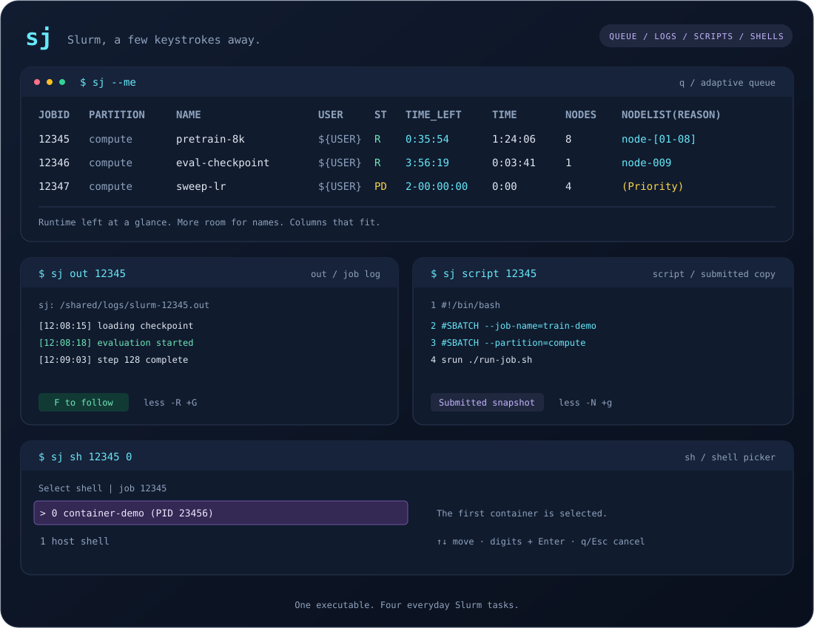

<div align="center">

# sj

### Slurm，几次按键就到位。

查看队列。打开日志。检查脚本。进入作业。

<p>
  
  
  
  
</p>

[English](README.md) · **简体中文**

[快速开始](#快速开始) · [安装](#安装) · [命令](#命令) · [全屏队列](#全屏队列----tui) · [自定义视图](#打造自己的队列视图) · [字段过滤](#按任意字段过滤) · [列内条目](#列内条目筛选) · [快捷键](#快捷键) · [开发](#开发)



<sub>示意会话。作业名、节点和日志内容均为示例。</sub>

</div>

`sj` 用一个小巧的 Rust 可执行文件，串起日常 Slurm 工作的四个步骤：查看运行状态、找到作业日志、检查提交脚本、在正确的节点或已有 Enroot 容器中打开 shell。

## 为什么选择 sj？

| 接下来要做什么 | 一条命令 | 得到什么 |
| --- | --- | --- |
| 查看队列 | `sj --me` | 适应终端宽度的列、剩余运行时间，以及优先留给作业名的空间。 |
| 交互浏览 | `sj --tui --me` | 支持滚动、实时刷新和任务详情的全屏队列。 |
| 阅读输出 | `sj out 12345` | 从 Slurm 元数据定位 sbatch 日志，并用 `less` 打开。 |
| 检查提交内容 | `sj script 12345` | 从头查看提交脚本，并显示行号。 |
| 检查运行中的作业 | `sj sh 12345` | 先选节点，再进入容器或宿主机 shell。 |

- **宽窄都清楚。** 宽屏显示 `TIME_LEFT`、`TIME`、`PARTITION` 和 `NODELIST(REASON)`，窄屏自动压缩布局。
- **自己的队列视图。** 从所有原生 Slurm 字段中选择列，配置响应式 TOML 规则与终端配色。
- **只留关心的作业。** 任意字段支持正则与 glob、逻辑条件组合，也能把默认过滤保存在视图中。
- **熟悉的筛选方式。** 继续使用 `--me`、`--start`、`-u`、`-j`、`-t`、`-p` 等 `squeue` 选项。
- **菜单刚好装得下。** 节点和容器列表按终端高度滚动，随窗口缩放调整。
- **容器优先。** Enter 确认当前高亮的容器，宿主机 shell 始终排在最后。
- **一个可执行文件。** Linux x86_64 和 aarch64 发布二进制采用静态链接，无需激活 venv，也无需 Python 或 Rust 运行环境。

## 快速开始

```bash
sj --me                       # 本人的队列，自适应终端宽度
sj --tui --me                 # 全屏队列，可打开任务详情
sj --me --start               # 等待中的作业及预计开始时间
sj out 12345                   # 从作业日志末尾开始查看
sj script 12345                # 从头查看提交时的脚本副本
sj sh 12345                    # 选择节点，再选择 shell
```

将 `12345` 替换为自己的作业 ID。首次使用请先查看[安装](#安装)。

## 安装

### 运行时要求

| 功能 | `PATH` 中需要有 |
| --- | --- |
| 队列 | `squeue`；全屏控制器详情使用 `scontrol` |
| 日志 | `sacct`、`scontrol`、`less` |
| 提交脚本 | `scontrol`；历史查询需要 `sacct`；交互查看需要 `less` |
| 节点与容器 shell | `scontrol`、`srun`；进入容器时目标节点还需要 `enroot` |

Release 支持 **x86_64 和 aarch64 Linux**，采用 musl 静态二进制。使用 `sh` 时，可执行文件的路径必须在计算节点上也能访问，通常放在共享 home 目录中；登录节点与计算节点的架构需要兼容。

### 下载 Release

从 [Releases](https://github.com/flymin/sj/releases) 下载与 Linux 架构匹配的压缩包：

| 架构（`uname -m`） | Release 目标 |
| --- | --- |
| `x86_64` | `x86_64-unknown-linux-musl` |
| `aarch64` | `aarch64-unknown-linux-musl` |

```bash
SJ_VERSION=0.3.1
SJ_TARGET="$(uname -m)-unknown-linux-musl"
SJ_ARCHIVE="sj-v${SJ_VERSION}-${SJ_TARGET}.tar.gz"
curl -fLO "https://github.com/flymin/sj/releases/download/v${SJ_VERSION}/${SJ_ARCHIVE}"
curl -fLO "https://github.com/flymin/sj/releases/download/v${SJ_VERSION}/SHA256SUMS"
sha256sum --check --ignore-missing SHA256SUMS
tar -xzf "$SJ_ARCHIVE" sj
mkdir -p "$HOME/.local/bin"
install -m 755 sj "$HOME/.local/bin/sj"
export PATH="$HOME/.local/bin:$PATH"
```

压缩包包含可执行文件、双语 README、终端预览和 MIT `LICENSE`。二进制不需要 Rust 或 Python 运行环境；上表列出的 Slurm 命令仍需在运行时可用。

### 构建与安装

构建脚本使用**已有的 uv venv** 存放编译工具链：优先读取 `SJ_VENV`，其次为当前激活的 `VIRTUAL_ENV`，最后默认为 `$HOME/.venvs/dev`。源码可以克隆到任意目录。

```bash
git clone https://github.com/flymin/sj.git
cd sj

# 首次配置工具链；已经配置时可跳过。
SJ_VENV="$HOME/.venvs/dev" SJ_UV="$(command -v uv)" ./setup-toolchain.sh

# 检查、构建并安装静态二进制。
SJ_VENV="$HOME/.venvs/dev" ./build.sh

export PATH="$HOME/.local/bin:$PATH"
sj -h
```

构建脚本检查格式、运行测试和 Clippy、编译 release、确认静态链接，默认安装到 `~/.local/bin/sj`，可通过 `SJ_INSTALL_DIR` 指定其他安装目录。构建输出保存在 `.logs/build.log`，临时构建目录在退出时清理。构建和工具链配置日志中的本地用户名、文件系统路径会替换为环境变量占位符；二进制中的编译路径也会映射为匿名路径。文档和预览使用虚构标识。

## 命令

| 命令 | 用途 |
| --- | --- |
| `sj [q] [OPTIONS]` | 展示队列；`q` 是默认命令。 |
| `sj out JOBID [OPTIONS]` | 打开 stdout、stderr，或仅输出解析后的日志路径。 |
| `sj script JOBID [OPTIONS]` | 查看 Slurm 保存的提交脚本，或用 `--raw` 输出原文。 |
| `sj sh JOBID [NODE_INDEX] [OPTIONS]` | 选择节点，进入容器或宿主机 shell。 |
| `sj config path\|views\|check [--config FILE]` | 定位、列出或校验队列配置。 |
| `sj help [COMMAND]` | 查看总览或某个子命令的帮助。 |

所有层级都支持 **`-h` 和 `--help`**，与 `sj help <COMMAND>` 展示同一份精简帮助。`sj -h` 列出子命令，各命令帮助按用途分组选项并给出少量示例。配置动作提供独立帮助，例如 `sj config check -h` 或 `sj help config check`。查看帮助不连接 Slurm，也不创建配置文件；完整语法和行为见下文，原生参数列表使用 `squeue --help`。

### 队列 · `q`

```bash
sj q --me --start
sj q --me -t RUNNING -i 5
sj q -u "${USER}" -p compute --width 120
sj q --me --noheader
sj q --me --json
```

布局优先给作业名留出空间。宽屏同时显示 **`TIME_LEFT`** 和 **`TIME`**（已运行时间），以及 `PARTITION` 和原生 `NODELIST(REASON)`。终端变窄时，先隐藏 `TIME_LEFT`。剩余时间表示 Slurm 作业时限中尚未消耗的运行时间，不是工作负载预计何时完成；等待中作业显示尚未消耗的运行时限。

需要继续压缩时，时间、`USER`、`JOBID` 分别允许缩至 **5**、**5**、**7** 个显示字符；短内容不会被强行补足这些最小宽度。长时间改用 `1d02h`、`1h23m`、`12h` 等短格式，无限时限和未知值在需要时显示为 `∞`、`?`。作业 ID 结尾加 `…`，用户名直接截断。宽度恢复后显示原始值；原生格式或 `--json` 不受终端宽度影响，可获取完整值。过长节点列表使用省略号截断，窄屏等待原因使用 `Prio`、`Res`、`Dep` 等简写。

`--start` 按 Slurm 原生语义展示等待中的作业，并按预计开始时间排序，主要时间列保持为 `START_TIME`；宽屏额外显示 `TIME_LEFT`。`-i 5` 每五秒刷新，重新计算列宽并获取最新剩余时间。省略 `--me` 时，用户范围沿用 `squeue` 默认设置。

在交互终端中，`-i` 会在队列上方添加类似 watch 的状态行：

```text
Every 5s                           Updated: 2030-01-02 03:04:05 +0000
```

时间戳记录最近一次成功更新的本地时间，并附带 UTC 偏移。窄屏下只保留时分秒，或将状态分为两行。`--noheader` 仅隐藏表格列标题，刷新信息仍然可见。重定向快照和 JSON 等原生格式保持原有输出，不添加状态行。

隐藏表头使用 **`--noheader`**；在 `sj` 中，`-h` 始终表示帮助。显式格式（`-o`、`-O`）、`--long` 和 JSON/YAML 使用原生 `squeue` 输出。step 默认使用可配置的自适应视图；明确指定原生输出选项时才直通。

### 全屏队列 · `--tui`

使用 alt screen 浏览队列，固定表头、选中任务高亮，Enter 打开居中详情弹窗：

```bash
sj q --tui --me                 # 默认每 5 秒刷新
sj --tui --me -i 2              # 每 2 秒刷新
sj q --tui --steps              # 浏览 job steps
sj q --tui --config ./sj.toml --view monitor
```

顶部显示刷新频率、上次成功更新时间、筛选后的任务数量和状态统计；底部显示选中任务 ID、行列位置和快捷键。任务数量对比的是保留行数与原生 Slurm 过滤后的查询行数；状态统计针对保留行。刷新后按 cluster 和完整 job/step ID 保持选中任务；任务消失时移动到相邻行。查询失败保留最近成功的快照和时间，显示 **STALE** 并允许重试。慢查询不会阻塞按键或窗口缩放，每个 Slurm 命令超时为 10 秒。

**当前 view 配置的全部列均可浏览。** 当前宽度规则决定优先排列，基础和其他规则 `order` 中缺少的列按配置顺序补到末尾，不区分大小写去重；所有 `order` 都未引用的列定义不会自动加入。宽度规则仍决定列属性和主题。TUI 跳过因终端宽度不足而触发的压缩、可选列隐藏和堆叠，保留每列的对齐、格式、条目筛选、preferred/max 宽度和截断方式。`preferred_width` 是起始分配宽度：与普通输出一致，有剩余屏幕空间时按 `grow_priority` 扩展到自然宽度，并遵守 `max_width`。左右滚动查看其余列，详情查看完整字段。

详情弹窗分为 **Overview / Raw / Stdout**：概览按身份、状态、时间、资源、节点、路径分组，先展示已有队列快照，再查询确切任务的控制器信息。Raw 展示已查询的原始队列字段及完整控制器响应，不应用仅影响展示的条目筛选。控制器详情独立显示更新时间，仅在打开或在 Overview / Raw 中按 `r` 时查询；后台队列继续刷新。不支持 JSON 的 `scontrol` 回退为文本详情；控制器不可用或任务过期时仍可阅读快照。数组汇总行提示使用 `--array`，不任意取第一个元素。

**只有选中 Stdout 标签页时才加载日志。** 路径沿用 `sj out` 的解析方式，首次进入时定位到文件末尾，按需分页读取并使用有界缓存，不限制可浏览的文件大小或行数。关闭折行时，读取窗口会按视口行数自适应扩展，避免长记录导致屏幕只显示一行；窗口放大时补充加载。上下滚动、翻页时继续加载，Home / End 跳到文件开头／末尾。状态栏在百分比旁显示 `Line 当前行/总行数`，当前行指视口顶部的日志逻辑行，折行不会增加行数。后台统计使用有界的稀疏索引，统计完成前显示 `Line …/… (counting)`，首次加载后即可阅读日志；首次尾部视图会先流式构建有界 ANSI 解析索引，在系统支持时跳过稀疏空洞，以正确处理跨读取窗口的控制序列，无需将整份文件保存在内存中。计数跟随缓存快照，按 `r` 后重新统计，离开 Stdout 会取消未完成的统计。Raw 和 Stdout **默认不折行**，用左右键查看长行，Ctrl+左右键横向翻页；按 `w` 切换折行，底部显示当前状态。切换复用缓存，并尽量保持 Stdout 阅读位置；文件需在当前主机可读，step 显示所属 allocation 的 sbatch stdout。各标签页保留滚动位置，再次切入 Stdout 使用已有缓存；在 Stdout 中按 `r` 重新打开文件、查看追加或轮换后的输出，队列刷新不会重复加载日志。切离或关闭详情会取消尚未完成的 stdout 工作。文件系统调用卡住时仍可离开视图，等待文件系统响应的读取线程数量有固定上限。刷新失败仍保留已有快照；文件未生成或不可读时显示错误，可按 `r` 重试。显示时去掉 ANSI 样式，将回车进度更新拆为独立行。

**搜索与翻页快捷键。** 在 Stdout 中按 `/` 输入字面文本，Enter 确认后从当前位置向后搜索，区分大小写。`n` 查找下一处，`N` 查找上一处，默认到文件首尾后停止；设置 `[tui].search_wrap = true` 可开启循环搜索。可见匹配会高亮，折行后也能显示。Backspace 编辑，Ctrl+U 清空，方向键上召回上次搜索；直接按 Enter 可重复上次搜索。Esc 取消编辑或正在执行的扫描。搜索在后台进行，内存有界，不会重复查询 Slurm。`g` / `G` 跳到文件首尾，`j` / `k`、`h` / `l` 移动，`f` / `b` 翻整页，`d` / `u` 翻半页；Ctrl+F/B/D/U 同样支持。

| 按键 | 操作 |
| --- | --- |
| ↑ / ↓ | 上一个／下一个任务；弹窗内滚动。 |
| ← / → | 横向滚动 8 个显示单元；不折行时在 Raw / Stdout 中查看长行。 |
| Ctrl+← / Ctrl+→ | 横向滚动一屏。 |
| PgUp / PgDn | 按可见行数翻页，或滚动弹窗。 |
| Home / End | 首个／最后一个任务，或详情起点／终点。 |
| Enter | 打开选中任务详情。 |
| Tab / Shift+Tab | 下一个／上一个详情标签：Overview、Raw、Stdout。 |
| `w` | 切换 Raw / Stdout 折行，默认关闭。 |
| `/`、`n`、`N` | 编辑 Stdout 字面文本搜索；下一处／上一处匹配。 |
| `g` / `G` | Stdout 文件开头／末尾。 |
| `j` / `k`、`h` / `l` | Stdout 向下／向上、向左／向右移动。 |
| `f` / `b`、`d` / `u` | Stdout 翻整页／半页，也支持 Ctrl 组合。 |
| Space | 暂停／恢复自动队列查询。 |
| `+` / `-` | 加快／减慢，步长 1 秒，最低 1 秒。 |
| `r` | 刷新队列，或当前标签的控制器详情／Stdout。 |
| `?` / F1 | 快捷键帮助。 |
| `q` / Esc | 关闭弹窗；主界面中退出。 |
| Ctrl+C | 从任何界面退出并恢复终端。 |

```toml
[tui]
refresh_seconds = 5
search_wrap = false # true：到文件首尾后从另一端继续搜索

[theme.tui]
title = { fg = "cyan", bold = true }
selected = { fg = "white", bg = "blue", bold = true }
border = { fg = "bright_black" }
key = { fg = "cyan", bold = true }
error = { fg = "red", bold = true }
muted = { fg = "bright_black" }
```

CLI `-i` 优先于 `[tui].refresh_seconds`，运行中的调整不写回配置。TUI 样式沿用全局 → 视图 → 宽度规则的主题继承；背景使用终端默认色，状态色复用现有主题。`NO_COLOR` 和 `--color never` 下仍保留选中标记和文字状态。窗口缩放保持任务选择和横向字段位置；极小窗口提示调整尺寸，退出按键继续可用。

TUI 要求 stdin/stdout 都是终端，不能与原生输出格式、`--list-fields`、`--width`、`--noheader` 同用。现有普通 queue 和 `-i` 行为不变，配置 schema 保持 1，已有配置文件不会被覆盖。

### 按任意字段过滤

使用 **`--filter EXPR`** 保留匹配的 job 或 step，通过 `and`、`or`、`not` 和括号组合条件；对一组条件取反即可排除。表达式可以引用所选 Slurm 字段目录中的任意完整字段名，包括当前视图未显示的字段。

```bash
sj --me --filter 'Name =~ "^train" and State == "RUNNING"'
sj q --filter '(Name glob "train-*" or Partition glob "debug-*") and not (Name glob "*test*")'
sj q --steps --filter 'StepName glob "worker-*"'
sj q --filter 'Account == "research"' --filter 'Name !~ "test|debug"'
sj q --no-view-filter --filter 'Name glob "eval-*"'
```

| 运算符 | 含义 |
| --- | --- |
| `==`、`!=` | 完整字符串相等 / 不等。 |
| `=~`、`!~` | 正则搜索 / 正则不匹配。用 `^`、`$` 限定完整匹配，`(?i)` 启用正则大小写忽略。 |
| `glob` | 整个字段的 Unix shell 通配匹配：`*`、`?`、`[abc]`、`[!abc]`；通配符也能跨 `/` 和匹配开头的点。匹配字面通配字符时使用括号，如 `[*]`。 |
| `not` / `!` | 对一个条件或条件组取反。 |
| `and` / `&&` | 两个条件都满足。 |
| `or` / `||` | 任一条件满足。 |
| `(...)` | 显式指定条件分组。 |

比较运算优先，然后依次为 **NOT → AND → OR**；AND、OR 短路求值。逻辑关键字与字段名不区分大小写，字段值默认区分大小写。比较按字符串执行，包括看起来像数字的字段。所有引用字段及模式均在查询作业前校验，短路分支中的引用也会检查。

值必须加引号。表达式内部的**单引号**保留原文，适合包含反斜杠的正则；**双引号**使用 JSON 转义。外层 shell 引号是另一个独立层次：

```bash
sj q --filter "Name =~ '^train-\d+$'"       # 表达式内部使用原样字符串
sj q --filter 'Name =~ "^train-\\d+$"'     # 表达式内部使用 JSON 转义字符串
```

sj 自身不展开变量；需要使用 `${USER}` 等环境变量时，按 shell 的引号规则展开。正则采用 Rust [regex crate](https://docs.rs/regex/latest/regex/#syntax) 语法，glob 采用 [glob crate](https://docs.rs/glob/latest/glob/struct.Pattern.html) 的 Unix shell 模式；匹配过程不会执行 shell 命令或搜索文件系统。

可以在命名视图中保存默认条件：

```toml
[views.queue]
filter = 'not (Name glob "*test*")'
```

最终条件为**视图过滤 AND 所有命令行过滤**。重复 `--filter` 表示继续做 AND，OR 写在表达式内部。`--no-view-filter` 只忽略所选视图的默认过滤，命令行条件和 Slurm 原生筛选仍生效。宽度规则只影响布局，不允许定义过滤条件。

先执行原生 `squeue` 筛选，再由 sj 匹配原始字段字符串，之后才进行显示清理、原因简写、时间压缩、截断和着色。例如 `Reason == "None"` 匹配原生字符串，即使该单元格显示为空白。只有保留的记录参与列宽计算。零匹配时正常保留表头，使用 `--noheader` 则输出为空。

表达式与模式在启动时编译，`-i` 刷新复用它们，并对最新记录重新筛选。窗口缩放只改变布局，不改变过滤条件。修改视图过滤后需重启 sj；`sj config check` 会校验所有配置过滤的表达式、模式及引用字段，不查询作业。

`--filter`、`--no-view-filter` 适用于自适应输出，不能与 `--list-fields`、JSON/YAML、`-o`、`-O` 等原生输出选项组合。原生输出继续跳过配置读取。错误会标明表达式位置；配置错误同时标明文件及视图。

### 打造自己的队列视图

命名视图、可复用列定义、响应式规则和终端主题，都放在一份 **TOML** 配置中。首次运行自适应队列时，自动在 `${XDG_CONFIG_HOME}/sj/config.toml` 生成带完整注释的默认配置；XDG 未设置、为空或为相对路径时，使用 `${HOME}/.config/sj/config.toml`。已有文件不会被覆盖。默认位置无法创建时会警告并使用内置配置；已有配置损坏，或明确指定的文件缺失、无效时，则直接报错。

```bash
sj config path                               # 定位配置文件
sj config views                              # 列出命名视图
sj config check                              # 校验 TOML 和本机 Slurm 字段
sj q --list-fields                           # 本机 Slurm 支持的所有 job 字段
sj q --steps --list-fields                    # step 使用独立的字段目录
sj q --config ./sj.toml --view monitor --me -i5
sj --view compact --me                       # 默认队列快捷方式同样支持这些选项
sj q --steps                                 # step 也使用自适应布局
```

帮助、版本、字段列表、原生输出以及 `sj config` 都不会创建配置文件。`config check` 只读取本机 job/step 字段目录，不查询作业。`--config` 也可以放在显式 `q` 或 `config` 命令前。

内置视图包括 **`queue`**、**`start`**、**`steps`** 和 **`compact`**。顶层的 `default_view`、`start_view`、`steps_view` 指定默认选择；`--view` 优先级最高，否则 `--steps` 优先于 `--start`。所选 Slurm 字段目录中的任意完整字段名都能用作列，例如 `Account`、`QOS`、`NumCPUs`、`WorkDir`。字段名不区分大小写，不接受缩写。

不支持 `--helpFormat` 的 Slurm 使用内置兼容字段目录，包含上游 22.05 与 23.11 共同支持的完整命名字段。`--list-fields` 会在 stderr 标明该回退；兼容目录之外的版本特有字段仍可通过显式原生输出访问。其他命令失败仍正常报错。`config check` 会分别检查 `default_view`、`start_view` 是否适用于 job，以及 `steps_view` 是否适用于 step。

自定义文件可以只写需要修改的属性。表按属性合并，数组整体替换。修改内置视图排序时，如果不想保留其宽度规则，请设置 `rules = []`。下面是一份完整的自定义视图示例：

```toml
schema_version = 1
default_view = "monitor"

[columns.Name]
max_width = 60

[views.monitor]
order = ["JobId", "Name", "StateCompact", "TimeLeft"]

[views.monitor.columns.Name]
preferred_width = 32
align = "left"

[[views.monitor.rules]]
min_width = 120
order = [
  "JobId", "Partition", "Name", "UserName",
  "StateCompact", "TimeLeft", "TimeUsed", "ReasonList"
]

[views.monitor.rules.columns.UserName]
max_width = 12

[views.monitor.rules.theme.header]
fg = "#8be9fd"

[theme]
header = { fg = "cyan", bold = true }
status = { fg = "bright_black" }
state_scope = "state"

[theme.states]
RUNNING = { fg = "green" }
PENDING = { fg = "yellow" }
```

列定义写在 `[columns.<Field>]` 下；视图内覆盖写在 `[views.<Name>.columns.<Field>]` 下；规则内覆盖写在 `[views.<Name>.rules.columns.<Field>]` 下。

| 属性 | 含义 / 新列默认值 |
| --- | --- |
| `title` | 表头，默认使用字段名。 |
| `format` | `auto`、`raw`、`duration`、`timestamp`、`reason`；`auto` 识别常见 Slurm 时间和原因字段。持续时间支持 Slurm 时钟格式和整数秒（包括 `PendingTime`）。 |
| `align` | `left`（默认）或 `right`。 |
| `min_width` | 显示宽度压缩下限，默认 `1`；短内容不强制补足。 |
| `preferred_width` | 初始分配宽度，限制在下限与自然宽度之间；省略时使用自然宽度。 |
| `max_width` | 最大显示宽度；省略时不设上限。 |
| `overflow` | `ellipsis`（默认）或 `truncate`。 |
| `optional` | 空间不足时是否允许隐藏，默认 `false`。 |
| `shrink_priority` | 压缩至下限的优先级，数值越小越早，默认 `20`。 |
| `hide_priority` | 隐藏可选列的优先级，数值越小越早，默认 `70`。 |
| `grow_priority` | 分配剩余空间的优先级，数值越小越早，默认 `10`。 |
| `entries` | 可选的展示条目筛选：`include`、`exclude`、`separator`、`key_separator`；默认关闭，详见[列内条目筛选](#列内条目筛选)。 |
| `style` | 列单元格样式：`fg`、`bg`、`bold`、`dim`、`italic`、`underline`。 |

自然宽度取表头和格式化内容中的最大显示宽度，并受 `max_width` 限制。压缩与隐藏共用一套优先级：数值越小越早执行，同值时先压缩再隐藏，最后按列顺序决定；压缩只削减所缺的宽度。剩余空间按增长优先级补回自然宽度。必选列仍无法放下时，每个 job 改用 `title: value` 堆叠换行，保留完整的必选字段值；`--noheader` 省略标签。

规则的 `min_width`、`max_width` 均包含边界，也可省略任意一项。所有匹配规则按文件顺序覆盖，后面的属性生效；规则可修改 `order`、列属性和主题。配置只在**启动时读取一次**；`-i` 每次查询后从基础配置重新匹配宽度规则，终端缩放也会生效。编辑配置后需要重启 sj 才会重新读取文件。

主题支持 `header`、`row`、刷新 `status` 样式。颜色接受 16 个名称（`black` 至 `white` 及其 `bright_*` 版本）、`0..255` 索引、`"#RRGGBB"` 或 `"reset"`。样式逐属性继承，`false` 清除继承的属性，`fg` / `bg = "reset"` 清除颜色。主题按全局 → 视图 → 匹配规则覆盖。`theme.states` 使用完整状态名；`state_scope = "state"` 只给状态列着色，`"row"` 给整行着色。单元格样式优先级为行 → 整行状态 → 列 → 状态单元格，其中只应用所选状态范围。

`--color auto` 在终端启用颜色，遵守 `NO_COLOR`，且在 `TERM=dumb` 时禁用样式。`--color always` 也为重定向输出着色，`--color never` 禁用样式。补齐、截断和换行先按 Unicode 显示宽度计算，再添加 ANSI 样式；每个单元格或行结束时重置。原生输出保持原样，不能与 `--view` 同时使用。

### 列内条目筛选

只展示资源或键值字段中关心的条目，不改变 job 匹配结果。该功能**默认关闭**，可用于任意配置列；字段尚未展示时，需要先将它加入视图的 `order`。

让已有资源列只显示 CPU、内存和设备：

```toml
[views.queue.columns.tres-alloc.entries]
include = ["cpu", "mem", "gres/*"]
```

```text
筛选前：cpu=16,mem=64G,node=1,billing=16,gres/gpu=2
筛选后：cpu=16,mem=64G,gres/gpu=2
```

也可以只排除指定键，保留其他条目：

```toml
[columns.tres-alloc.entries]
exclude = ["node", "billing"]
```

模式区分大小写，匹配**完整键名**，支持 `*`、`?`、`[abc]`、`[!abc]`；`gres/*` 也能匹配 `gres/gpu:demo` 等带子类型的键。空 `include` 允许所有键，`exclude` 优先排除。保留条目原顺序、重复项和值；启用筛选时去掉每个条目两端的空白，用 `separator` 重新连接；没有保留项时单元格为空。

`separator` 默认 `","`，`key_separator` 默认 `"="`。两者都是非空、不含控制字符且互不相同的字面量字符串。按第一个键值分隔符提取键名；没有分隔符的裸条目整体作为键名。例如，自定义 `Comment` 值 `team:research;owner:demo;debug:yes` 可以配置：

```toml
[columns.Comment.entries]
separator = ";"
key_separator = ":"
include = ["team", "owner"]
```

不解析条目内部的引号或转义分隔符，请按字段实际格式配置。设置沿全局列、视图列、匹配的宽度规则逐级继承，数组整体替换；取消继承的筛选需要清空**两个**列表：

```toml
[views.monitor.columns.tres-alloc.entries]
include = []
exclude = []
```

两个列表均为空时原文保持不变。条目筛选发生在格式化和列宽计算之前，堆叠输出及刷新同样生效。CLI 和视图的 job filter 仍读取完整原始字段：即使隐藏 billing，`--filter 'tres-alloc glob "*billing=*"'` 仍可匹配包含它的 job。原生输出绕过列配置。`sj config check` 校验条目模式和分隔符，自动生成的配置文件也提供了注释示例。

### 日志 · `out`

```bash
sj out 12345                       # 用 less 打开 stdout
sj out 12345 --err                 # stderr，或两路输出共用的日志
sj out 12345 --path                # 仅输出路径，不打开分页器
sj out 12340_3                     # 明确指定数组作业的任务
```

日志路径来自 Slurm 元数据，也支持 accounting 中保留的已完成作业记录。相对路径以作业工作目录解析。数组父 ID 对应多个日志时，需要指定明确的任务。

日志以 `less -R +G` 打开，从末尾开始查看。按 **F** 跟随新增输出，**Ctrl-C** 停止跟随，**q** 退出。只要元数据中已有路径，`--path` 就可以在文件创建前输出它；实际打开日志时，文件需要在当前主机上可读。

### 提交脚本 · `script`

```bash
sj script 12345                 # 用 less 查看 Slurm 保存的提交副本
sj script 12345 --raw           # 输出脚本原始字节
sj script 12345 > job.sbatch    # 保存提交时的副本
sj script 12340_3               # 明确指定数组任务
```

交互终端使用 `less -N +g` 从头查看，并显示行号。重定向和 `--raw` 只输出脚本原文，保留空白和末尾换行。查看的是 Slurm 保存的副本，也支持 `sbatch --wrap` 生成的脚本；提交后修改或删除本地原文件不会改变该副本。

先从控制器取回，失败后尝试 accounting 历史记录。历史脚本依赖集群已有的 `AccountingStoreFlags=job_script` 配置及尚未清理的记录。脚本缺失或权限不足时明确报错。数组父 ID 或异构作业匹配多个 allocation 时，需要指定明确的任务或组件 ID。查看过程不创建临时脚本文件。

### Shell · `sh`

```bash
sj sh 12345                            # 选择节点，再选择 shell
sj sh 12345 0                          # 在节点 0 上选择 shell
sj sh 12345 --nodes                    # 列出 allocation 中的节点编号
sj sh 12345 0 --list                   # 列出运行中的容器
sj sh 12345 0 --host                   # 直接进入宿主机
sj sh 12345 0 --container container-demo  # 按完整容器名进入
sj sh 12345 0 --container 23456        # 按 --list 给出的 PID 进入
```

节点编号从 **0** 开始，保留 Slurm 原始 allocation 顺序。单节点作业自动选择该节点；多节点作业省略编号时打开选择菜单。

容器排在前面，**host shell 始终作为最后一个可选项**。默认高亮第一个容器，直接 Enter 就会进入它；没有运行中容器时，host shell 是唯一选项。列表展示目标节点上当前用户可见的运行中 Enroot 容器，包含名称、代表 PID，以及能够识别的作业 ID。

`--container` 接受容器名或 **PID**，不是菜单编号。同名容器有多个运行实例时，用 PID 区分。`--nodes`、`--list`、`--host`、`--container` 互斥。

进入 shell 需要**本人拥有且处于 RUNNING 状态的作业**，并且需要交互终端。在脚本中使用 `--nodes`，或在多节点作业中明确给出节点编号后使用 `--list`。

## 快捷键

### 节点与容器菜单

| 按键 | 行为 |
| --- | --- |
| ↑ / ↓ | 移动高亮项。 |
| PageUp / PageDown | 按可见页翻动。 |
| Home / End | 跳到第一项或最后一项。 |
| 数字，再按 Enter | 选择从 0 开始的编号。 |
| Backspace | 修改输入的数字。 |
| Enter | 确认当前高亮项。 |
| q / Esc / Ctrl-C / Ctrl-D | 取消选择。 |

条目少时完整显示，条目多时在终端高度内滚动。窗口缩放时自动调整可见范围。菜单关闭时恢复终端画面、输入设置和光标。

### 日志查看器

| 按键 | 行为 |
| --- | --- |
| g / G | 跳到开头 / 末尾。 |
| F | 跟随新增输出。 |
| Ctrl-C | 停止跟随，恢复浏览。 |
| q | 关闭查看器。 |

## 开发

构建使用 **Rust 1.99.0**、edition 2024、`aarch64-unknown-linux-musl` 目标和自带的 `rust-lld`。依赖版本固定在 `Cargo.lock` 中。

```bash
./build.sh
```

测试覆盖配置生成与并发创建、配置覆盖与规则校验、字段目录、job/step 视图、布尔过滤与原始值、视图过滤叠加、主题、队列布局、时间短格式、剩余时间刷新、Unicode、原生参数透传、日志定位、数组 ID、脚本取回与字节保真、节点顺序、容器发现、精简 CLI 帮助、仅影响展示的列内条目筛选和全屏导航渲染。伪终端测试验证脚本分页及提前退出、方向键、数字输入、窗口缩放、取消选择、终端恢复，以及全屏查询取消和超时重试。构建脚本测试验证环境选择与日志匿名化。涉及 Slurm 的集成测试使用临时命令 mock。

### GitHub Actions

[CI and release](https://github.com/flymin/sj/actions/workflows/ci.yml) 在 PR、`main` 推送和版本 tag 时运行。两个架构分别使用 GitHub 原生 runner 和 Rust 1.99.0，检查格式、Python 构建与发布测试、Rust 测试、Clippy、静态 release 构建及二进制基本功能。成功后将压缩包和逐包校验文件上传为 Actions artifacts，保留 14 天。

发布新版本时，更新 `Cargo.toml`、`Cargo.lock` 中的 `sj` 版本、双语 README 的版本徽章和下载示例，并添加 `docs/releases/<VERSION>.md` 发布说明，然后提交并推送。创建与包版本一致的 tag：

```bash
git tag v0.3.1
git push origin v0.3.1
```

tag 必须精确等于 `v` 加包版本。两个架构全部通过后，流程创建 draft Release，上传两个压缩包和 `SHA256SUMS`，最后正式发布。`v0.3.1-rc.1` 等预发布版本会标为 prerelease。重跑不会覆盖已正式发布的附件；draft 上传失败时可以重试。Actions 的 **Run workflow** 选择分支时仅构建，选择匹配版本的 tag 时可重试发布。

发布使用 GitHub 自动提供的 `GITHUB_TOKEN`，无需个人 token。构建任务只有读取权限，只有发布任务获得 `contents: write`。本地仍可通过 `build.sh` 配置和构建；Actions 使用自身固定版本的工具链与 `scripts/ci-build.sh`。

<details>
<summary><strong>进阶行为与可移植性</strong></summary>

### 队列渲染

- 宽度依次取自终端、`COLUMNS` 和 120 列默认值。极窄时减少辅助列或使用多行。表格中的作业 ID 可以缩写；极窄屏的堆叠回退会换行保留完整的必选字段值。
- 刷新间隔支持 `-i 5`、`-i5`、`--iterate=5`。TTY 中重绘并显示刷新间隔及成功更新时间；重定向时连续追加快照，不添加状态信息。
- 开始时间在窄屏显示月日和时分，宽屏显示完整时间戳。
- 多集群输出带原生集群标题时，使用明确的原生格式或 JSON/YAML。

### 日志定位

- 通过 `sacct --expand-pattern` 解析已记录的路径；accounting 不可用时回退到 `scontrol` JSON。
- 回退逻辑支持 `%j`、`%A`、`%a`、`%b`、`%x`、`%u`、`%%` 及数字补零。按节点或任务拆分的复杂模板依赖 Slurm 原生展开。
- 使用元数据中记录的路径，不递归搜索文件系统。日志需要在运行 `out` 的主机上挂载且可读。

### Shell 执行

- 连接使用单个共享资源的 `srun` step，设置 `--nodes=1`、`--ntasks=1`、`--cpus-per-task=1`、`--overlap`、`--exact`、`--pty`。设备权限沿用 allocation，step 的资源等待使用 `--immediate=10`。
- 菜单采用 JSON 中的原始 allocation 顺序。新启动的交互 step 有自己的 node rank；这个单节点 step 的 `SLURM_NODEID` 通常为 0。
- 通过 mount namespace 合并可访问进程，并检查 Enroot 的 `/.lock` 标记，不依赖 `ENROOT_DATA_PATH`。缓存的容器根文件系统不会被列为运行中。
- 进入前检查 PID、进程启动时间和 namespace。`enroot exec` 加入已有容器，恢复其环境和工作目录。
- 容器内优先使用 `/bin/bash -l`，否则使用 `/bin/sh -l`。宿主机使用 `$SHELL -l`，找不到时回退到 bash/sh。

### 工具链配置

- 编译工具放在所选 venv 的 `opt/rust-1.99.0` 下，在其 `bin` 中提供 Rust 命令入口。Cargo 缓存位于 `share/cargo`。
- 配置脚本在 venv 内安装 patchelf，并解包隔离的 musl/libgcc 运行库；不编辑 `pyvenv.cfg` 或激活脚本，也不安装系统包。
- Rust 下载按发布 manifest 中的 SHA256 校验；运行库版本与 SHA256 固定在配置脚本中。
- `SJ_VENV`、`SJ_UV`、`SJ_INSTALL_DIR` 分别选择已有环境、uv 可执行文件和安装目录。`SJ_UV` 默认使用 `PATH` 中的 `uv`，其次为 `$HOME/.local/bin/uv`；安装目录默认为 `$HOME/.local/bin`。工具链已经可用时跳过配置。
- 交付的可执行文件不依赖共享库，但仍按功能调用集群的 Slurm 工具、`less` 和 `enroot`。

</details>

---

<div align="center">

README 的呈现方式参考了 [sqwatch](https://github.com/fedonman/sqwatch)。

[回到顶部](#sj) · [English](README.md)

</div>

## 许可证

[MIT](LICENSE) · Copyright (c) 2026 Ruiyuan Gao
